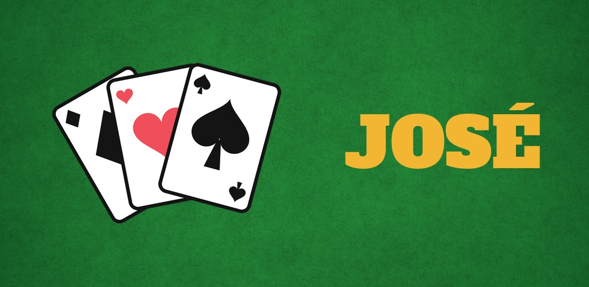
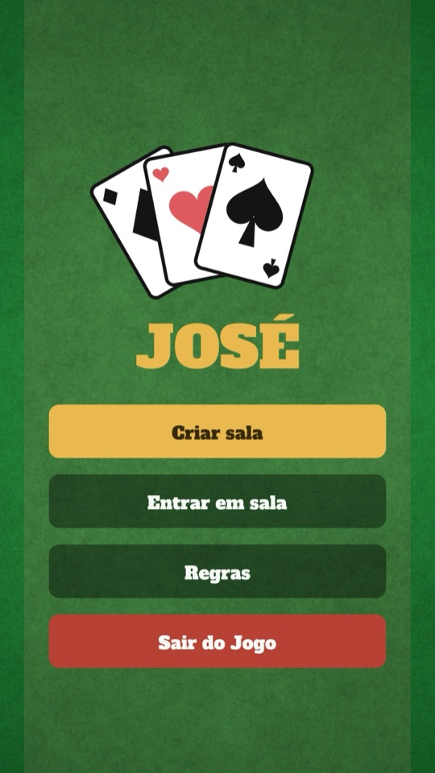
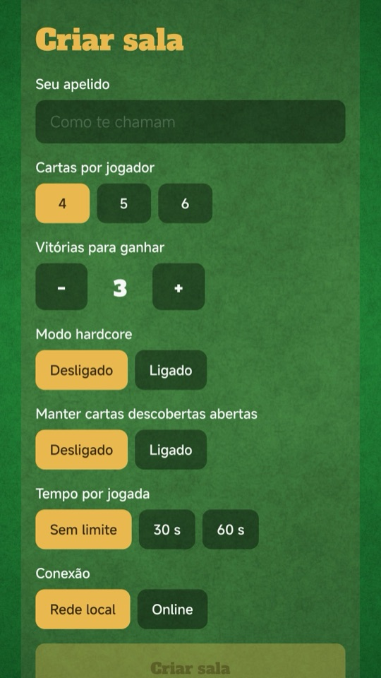
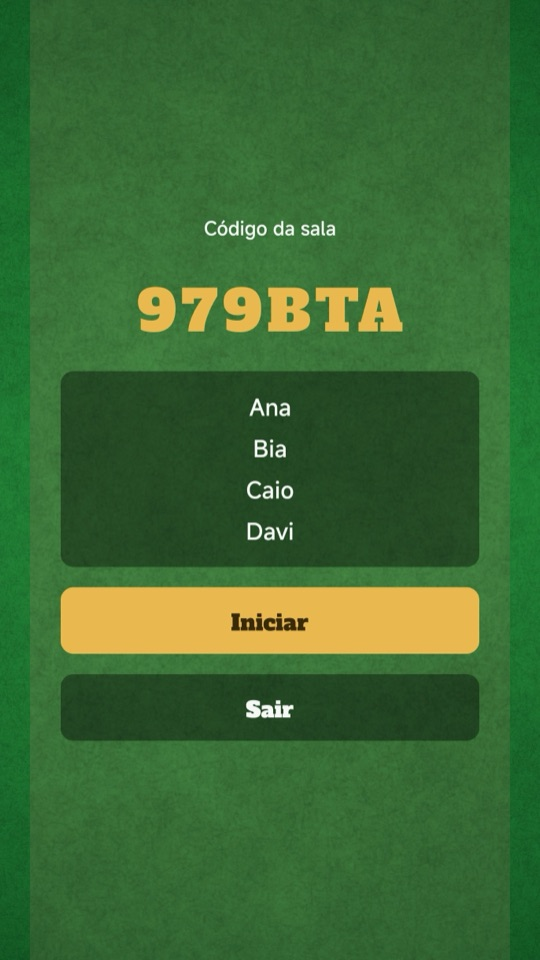
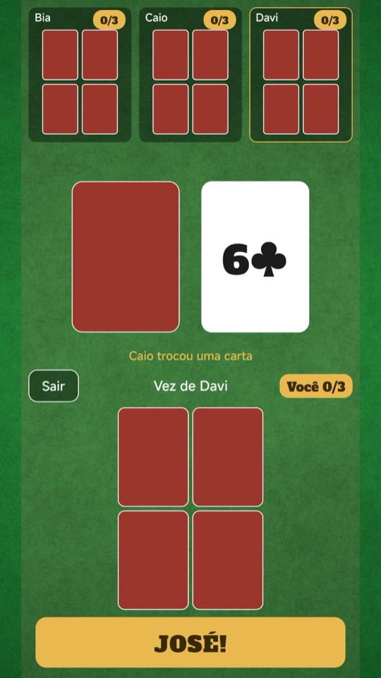
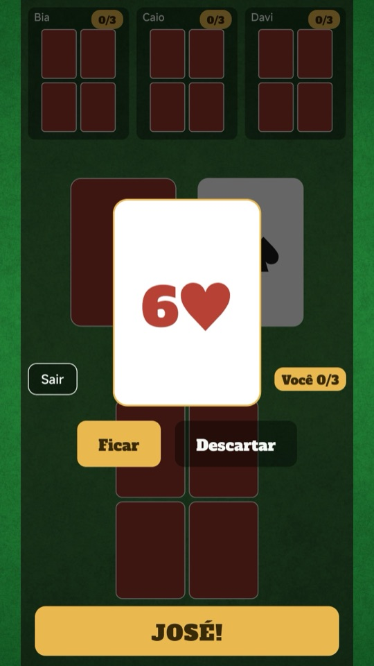
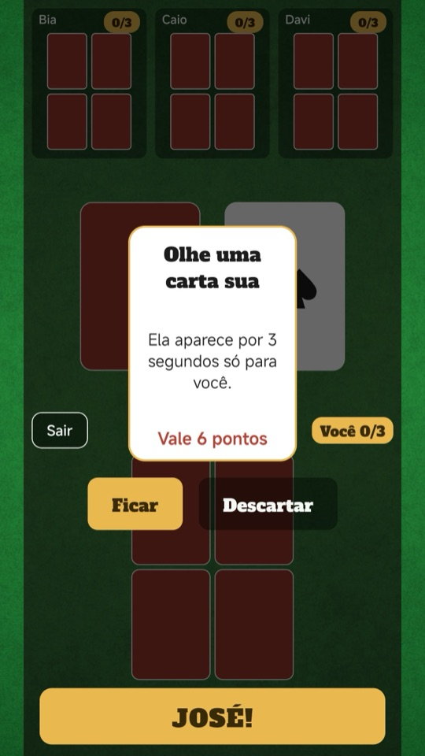
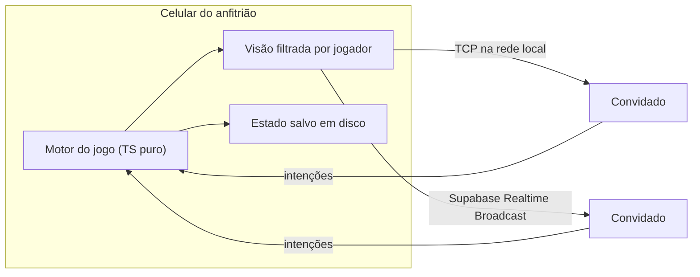

<h1 align="center">José</h1>

Jogo de cartas de memória para 2 a 4 pessoas, cada uma no próprio celular, pela internet ou pela rede local.

  
  

## Sobre

Cada jogador recebe de 4 a 6 cartas viradas para baixo e não pode olhar. Na sua vez, compra do monte ou do centro e decide se fica com a carta ou descarta. As cartas de 2 a 9 têm poderes: dar cartas a alguém, embaralhar a mão de outro jogador, espiar ou trocar. Quem acha que tem a menor soma grita "JOSÉ" e encerra a rodada.

A sala pode ser online, com um código, ou na rede local e no hotspot do celular, sem internet. O jogo tem tutorial, modo hardcore, tempo por jogada e uma mesa que funciona com o celular em pé ou deitado. Não precisa criar conta.

## Telas

| | | | | | |
|:-:|:-:|:-:|:-:|:-:|:-:|
|  |  |  |  |  |  |

## Como foi feito

- O motor do jogo é TypeScript puro e roda no celular de quem criou a sala. Esse aparelho decide o resultado de cada jogada; os outros mandam intenções e desenham o que recebem.
- Cada jogador recebe só a parte do estado que pode ver. A tela do próprio anfitrião também usa apenas a visão dele.
- Quando duas pessoas gritam "José" quase ao mesmo tempo, o app compensa a latência e a diferença de relógio de cada aparelho com uma medição no estilo NTP. Os gritos são reunidos numa janela curta, e um sorteio desempata os que chegam a menos de 30 ms um do outro.
- A mesma partida roda sobre TCP na rede local, com um módulo nativo em Swift e Kotlin, ou sobre o Supabase Realtime Broadcast pela internet. O código da sala indica qual dos dois usar.
- Os aparelhos mandam sinal de vida a cada 3 s, e quem cai tem um tempo para voltar. O estado é salvo depois de cada jogada, então a partida continua se o app fechar.
- O embaralhamento recebe uma semente, o que torna as partidas reproduzíveis nos testes com Jest e Testing Library. Os fluxos E2E rodam em Maestro.

## Arquitetura

## Stack

Expo SDK 58 · React Native 0.88 · React 19 · TypeScript · Reanimated 4 · Supabase Realtime · react-native-tcp-socket · módulo nativo (Swift/Kotlin) · Jest · Maestro · EAS Build/Update

## Meu papel

Criei as regras do jogo, a interface, o app e a camada de rede, e publiquei nas lojas.

O código-fonte é privado. Para ver uma demo ou conversar sobre o projeto, fale comigo em <a href="https://abisay.tech">abisay.tech</a> ou no <a href="https://www.linkedin.com/in/jahncarlos">LinkedIn</a>.
