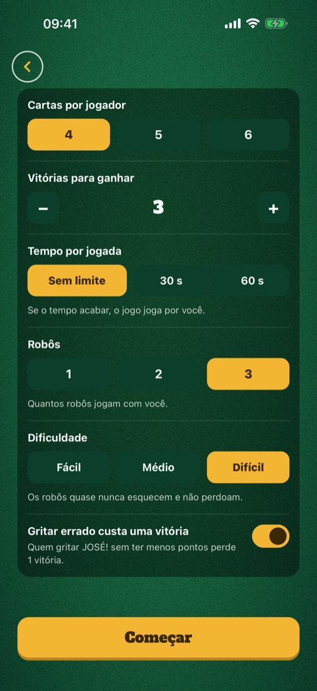
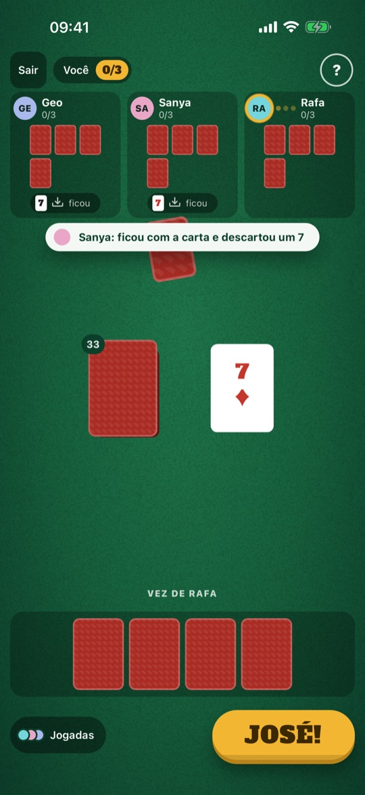
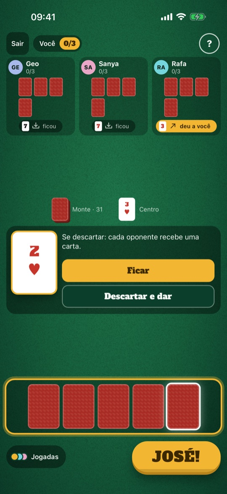
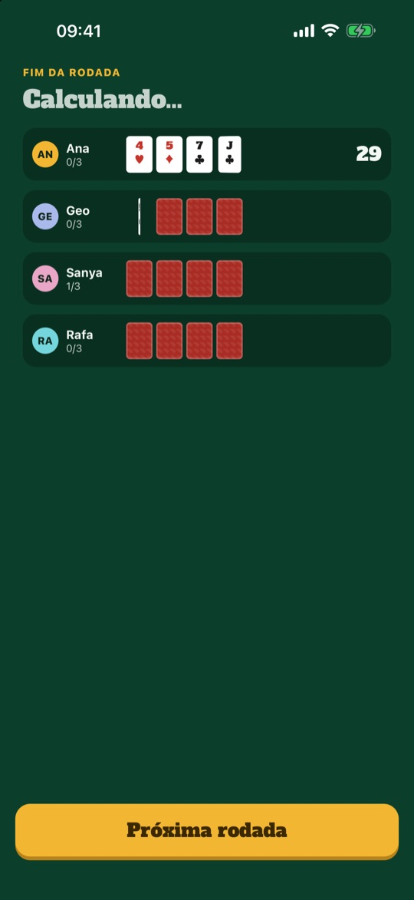
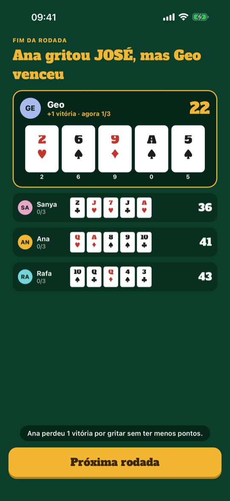
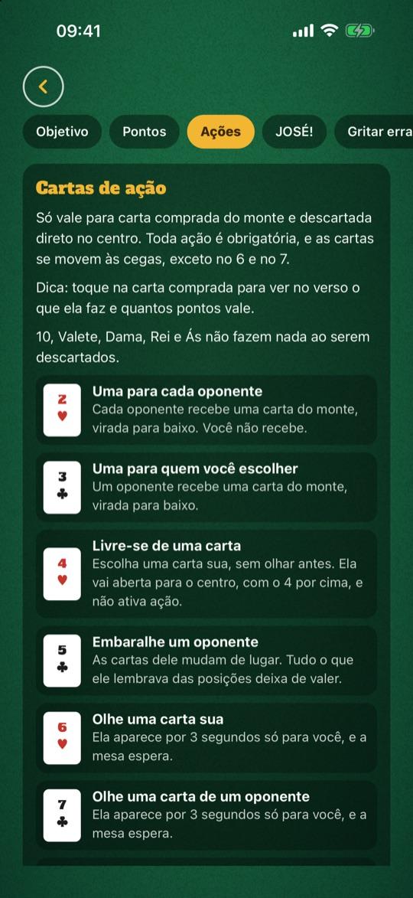
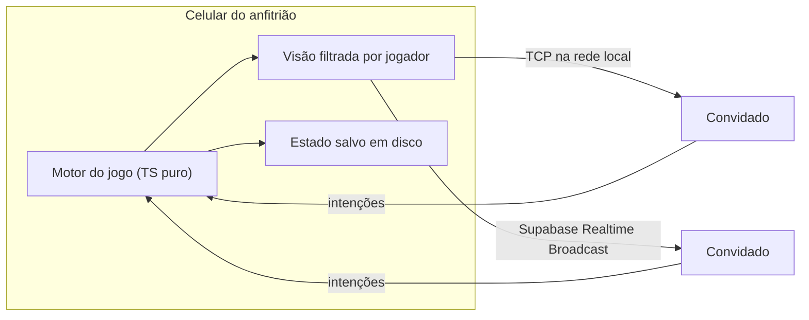

<h1 align="center">José</h1>

Jogo de cartas de memória para 2 a 4 pessoas, cada uma no próprio celular, pela internet ou pela rede local.

  
  

## Sobre

Cada jogador recebe de 4 a 6 cartas viradas para baixo e não pode olhar. Na sua vez, compra do monte ou do centro e decide se fica com a carta ou descarta. As cartas de 2 a 9 têm poderes: dar cartas a alguém, embaralhar a mão de outro jogador, espiar ou trocar. Quem acha que tem a menor soma segura o botão "JOSÉ!" por 2 segundos e encerra a rodada.

A sala pode ser online, com um código, ou na rede local e no hotspot do celular, sem internet. Sem ninguém por perto, o modo **Praticar** coloca você contra três robôs, Geo, Sanya e Rafa, no Fácil, no Médio ou no Difícil, também sem internet. O jogo tem tutorial em 8 capítulos, a opção "Gritar errado custa uma vitória", tempo por jogada e "Mesa devagar" para quem lê com calma. O celular joga em pé e o tablet deitado. Não precisa criar conta.

## Telas

| | | | |
|:-:|:-:|:-:|:-:|
|  Início |  Praticar contra os robôs |  Rafa pensando |  Carta comprada |
|  Calculando os pontos |  Fim da rodada |  Regras | |

## Como foi feito

- O motor do jogo é TypeScript puro e roda no celular de quem criou a sala. Esse aparelho decide o resultado de cada jogada; os outros mandam intenções e desenham o que recebem.
- Cada jogador recebe só a parte do estado que pode ver. A tela do próprio anfitrião também usa apenas a visão dele.
- Quando duas pessoas gritam "José" quase ao mesmo tempo, o app compensa a latência e a diferença de relógio de cada aparelho com uma medição no estilo NTP. Os gritos são reunidos numa janela curta, e um sorteio desempata os que chegam a menos de 30 ms um do outro.
- A mesma partida roda sobre TCP na rede local, com um módulo nativo em Swift e Kotlin, ou sobre o Supabase Realtime Broadcast pela internet. O código da sala indica qual dos dois usar.
- Os aparelhos mandam sinal de vida a cada 3 s, e quem cai tem um tempo para voltar. O estado é salvo depois de cada jogada, então a partida continua se o app fechar.
- O embaralhamento recebe uma semente, o que torna as partidas reproduzíveis nos testes com Jest e Testing Library. Os fluxos E2E rodam em Maestro.

### Os robôs do Praticar

- Os robôs só sabem o que veriam se fossem gente. Cada um é um jogador comum na mesa, numa rede em memória no próprio aparelho. Ele recebe a mesma visão filtrada que uma pessoa receberia e monta a memória a partir dos eventos de cada jogada: a carta que colocou na mão, a que espiou com o 7, a que trocou às cegas. Não há como roubar, porque as cartas escondidas nunca chegam a ele.
- Cada nível é definido por três eixos: **memória** (a chance de esquecer cada carta a cada volta), **velocidade** (o tempo pensando) e **audácia** (quanta vantagem estimada ele exige para gritar). Nenhum número chega a 100%: todo robô pode esquecer e errar.
- A cada partida, as personalidades (mestra, apostador e defensivo) são sorteadas entre os três, e a Geo fica com a de mestra em metade das vezes.
- Antes de gritar, o robô soma a dúvida: cada carta que ele não conhece aumenta a margem que exige. Ao descartar, ele pesa o valor de cada carta de ação na mesma régua de pontos. Para a mesa parecer gente, toda jogada leva pelo menos 1 s, com três pontinhos de "pensando".
- A força foi calibrada com centenas de rodadas simuladas, sem tela, contra um jogador de referência que esquece e erra como uma pessoa comum. Um robô vence 31% das rodadas no Fácil, 57% no Médio e 63% no Difícil.

### Testes nos aparelhos

- **Telas:** cada versão passa por um roteiro do Maestro em iPhone pequeno e grande, celular Android e tablet, girando o aparelho.
- **Animações:** os defeitos, como uma carta piscando no centro, foram achados gravando a tela do aparelho e medindo a cor quadro a quadro.

## Arquitetura

## Stack

Expo SDK 58 · React Native 0.88 · React 19 · TypeScript · Reanimated 4 · Supabase Realtime · react-native-tcp-socket · módulo nativo (Swift/Kotlin) · expo-haptics · Jest · Maestro · EAS Build/Submit/Update

## Meu papel

Criei as regras do jogo, a interface, o app, a camada de rede e os robôs, e publiquei nas lojas.

O código-fonte é privado. Para ver uma demo ou conversar sobre o projeto, fale comigo em <a href="https://abisay.tech">abisay.tech</a> ou no <a href="https://www.linkedin.com/in/jahncarlos">LinkedIn</a>.
